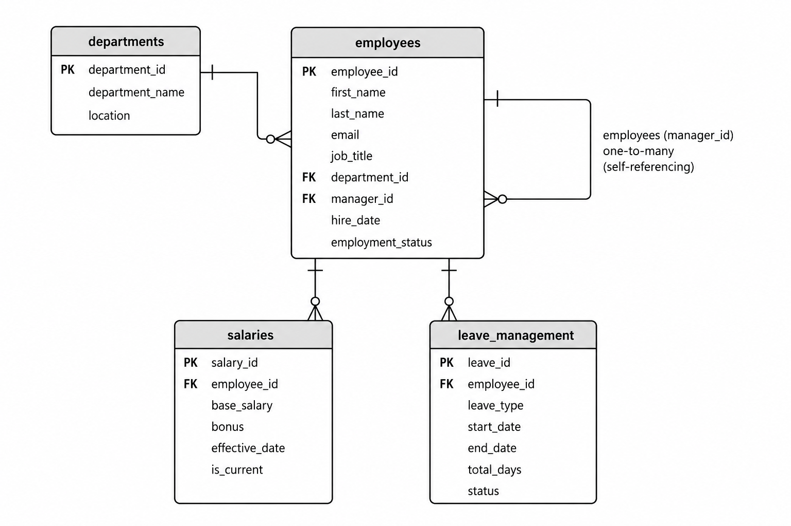

# Employee Management System

## Overview

The Employee Management System is a relational database built in PostgreSQL that models how a company tracks its employees, departments, salaries, and leave requests. It demonstrates practical relational database design along with a range of SQL querying and reporting techniques.

## Features

- Structured storage for employees, departments, salaries, and leave records
- Manager-to-employee reporting relationships
- Salary history tracking (current and historical salary records)
- Leave requests with type, status, and duration tracking
- Reusable views for common reporting needs
- A library of analytical SQL queries covering joins, aggregates, and more

## Technologies Used

- PostgreSQL
- pgAdmin
- SQL (DDL, DML, DQL)
- Git & GitHub

## Database Design

The database is named `employee_management_system` and consists of four core tables: `departments`, `employees`, `salaries`, and `leave_management`. Each employee belongs to a department and may report to another employee (a manager). Salaries and leave records are stored separately from the employee record so that history can be tracked over time without overwriting past data.

## Database Tables

**departments**
| Column | Type | Notes |
|---|---|---|
| department_id | SERIAL | Primary Key |
| department_name | VARCHAR(100) | Not Null, Unique |
| location | VARCHAR(100) | Not Null |
| created_at | TIMESTAMP | Default: current timestamp |

**employees**
| Column | Type | Notes |
|---|---|---|
| employee_id | SERIAL | Primary Key |
| first_name / last_name | VARCHAR(50) | Not Null |
| email | VARCHAR(150) | Not Null, Unique |
| phone | VARCHAR(20) | |
| job_title | VARCHAR(100) | Not Null |
| department_id | INT | Foreign Key -> departments |
| manager_id | INT | Foreign Key -> employees (self-reference) |
| hire_date | DATE | Not Null |
| employment_status | VARCHAR(20) | Check: Active / Inactive / Terminated |

**salaries**
| Column | Type | Notes |
|---|---|---|
| salary_id | SERIAL | Primary Key |
| employee_id | INT | Foreign Key -> employees |
| base_salary | NUMERIC(10,2) | Check: > 0 |
| bonus | NUMERIC(10,2) | Check: >= 0, Default 0 |
| currency | VARCHAR(10) | Default 'USD' |
| effective_date | DATE | Not Null |
| is_current | BOOLEAN | Marks the active salary record |

**leave_management**
| Column | Type | Notes |
|---|---|---|
| leave_id | SERIAL | Primary Key |
| employee_id | INT | Foreign Key -> employees |
| leave_type | VARCHAR(30) | Check: Sick / Vacation / Personal / Maternity-Paternity / Unpaid |
| start_date / end_date | DATE | Check: end_date >= start_date |
| total_days | INT | Check: > 0 |
| status | VARCHAR(20) | Check: Pending / Approved / Rejected |
| applied_date | DATE | Default: current date |

## Relationships

- One department has many employees (`departments.department_id` -> `employees.department_id`)
- One employee can manage many employees (`employees.employee_id` -> `employees.manager_id`)
- One employee has many salary records (`employees.employee_id` -> `salaries.employee_id`)
- One employee has many leave records (`employees.employee_id` -> `leave_management.employee_id`)

## ER Diagram



## SQL Concepts Demonstrated

- INNER JOIN, LEFT JOIN, and multi-table JOINs
- Self-joins (employee-to-manager relationship)
- Aggregate functions: COUNT, SUM, AVG, MIN, MAX
- GROUP BY and HAVING
- CASE expressions
- Subqueries (including correlated subqueries)
- Date operations (AGE, EXTRACT, interval arithmetic)
- Constraints: PRIMARY KEY, FOREIGN KEY, NOT NULL, UNIQUE, CHECK, DEFAULT
- Views for reusable reporting logic

## Aggregate Analysis

The query file includes analysis such as average and total salary by department, headcount per department, salary bands using CASE, leave-day totals by status and type, and employees earning above the company or department average.

## Views

Three views are provided in `views/01_create_views.sql`:

- **employee_details_view** — a readable summary of each employee (name, email, job title, department, hire date)
- **department_salary_summary** — employee count, average/min/max salary, and total salary expense per department
- **employee_leave_summary** — total leave records, total leave days, and approved leave days per employee

## Example Queries

```sql
-- Average salary by department
SELECT * FROM department_salary_summary ORDER BY average_salary DESC;

-- Employees earning above their department's average salary
SELECT e.first_name, e.last_name, d.department_name, s.base_salary
FROM employees e
JOIN departments d ON e.department_id = d.department_id
JOIN salaries s ON e.employee_id = s.employee_id
WHERE s.is_current = TRUE
  AND s.base_salary > (
      SELECT AVG(s2.base_salary) FROM employees e2
      JOIN salaries s2 ON e2.employee_id = s2.employee_id
      WHERE e2.department_id = e.department_id AND s2.is_current = TRUE
  );
```

More queries are available in `sql/03_queries.sql`.

## Screenshots

| Screenshot | Description |
|---|---|
| `screenshots/employees_table.png` | Employee list with department names |
| `screenshots/department_summary.png` | Department salary summary view |
| `screenshots/salary_analysis.png` | Salary analysis query results |
| `screenshots/leave_analysis.png` | Leave analysis query results |
| `screenshots/employee_view.png` | employee_details_view results |

## Project Structure

```
employee-management-system/
│
├── README.md
│
├── sql/
│   ├── 01_create_tables.sql
│   ├── 02_insert_data.sql
│   └── 03_queries.sql
│
├── views/
│   └── 01_create_views.sql
│
├── diagrams/
│   └── ER_diagram.png
│
└── screenshots/
    ├── employees_table.png
    ├── department_summary.png
    ├── salary_analysis.png
    ├── leave_analysis.png
    └── employee_view.png
```

## How to Run

1. Create a new database in PostgreSQL named `employee_management_system`.
2. Open the Query Tool in pgAdmin (or any PostgreSQL client) connected to that database.
3. Run `sql/01_create_tables.sql` to create the schema.
4. Run `sql/02_insert_data.sql` to load the sample data.
5. Run `sql/03_queries.sql` to explore the analytical queries.
6. Run `views/01_create_views.sql` to create the reporting views, then query them directly, e.g. `SELECT * FROM department_salary_summary;`

## Future Improvements

- Add a payroll/transactions table for month-by-month payment history
- Add role-based access control for HR vs. general employee views
- Add stored procedures for common leave-approval workflows
- Add automated tests for constraint and query validation

## Author

Maintained by [vipin280720081157-08](https://github.com/vipin280720081157-08)
